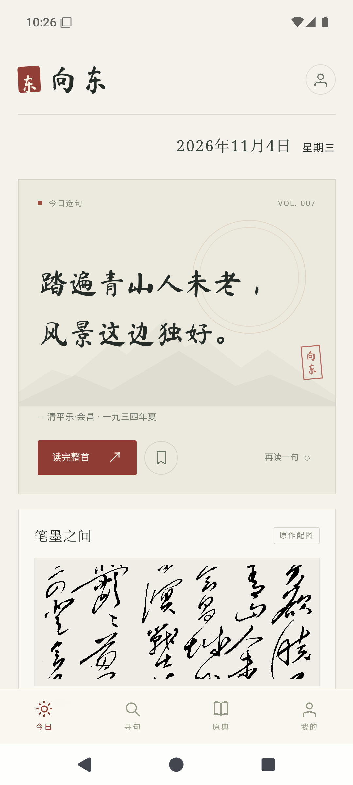
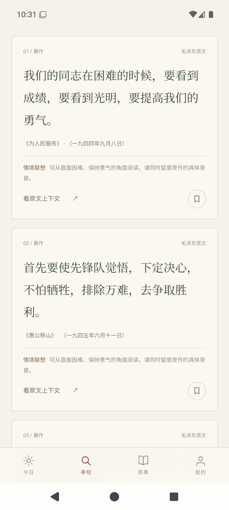
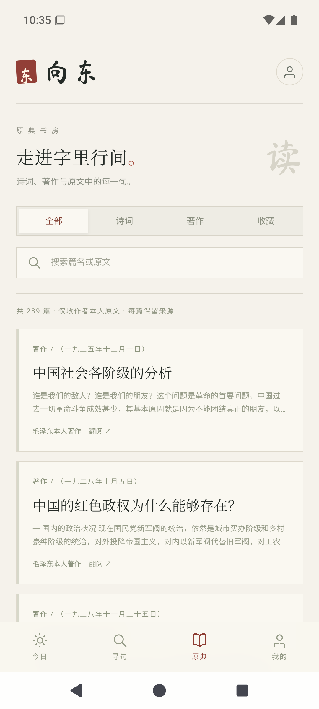
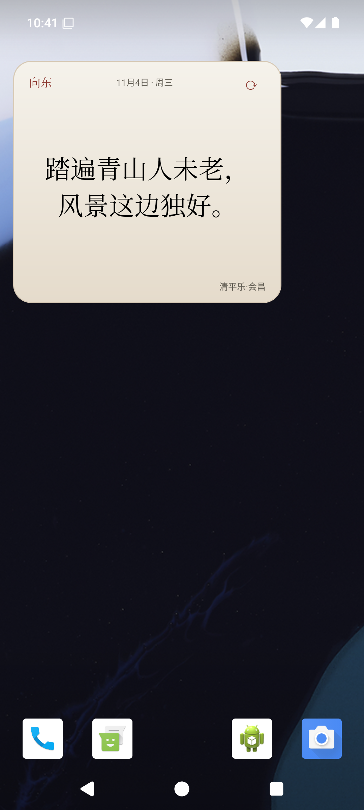
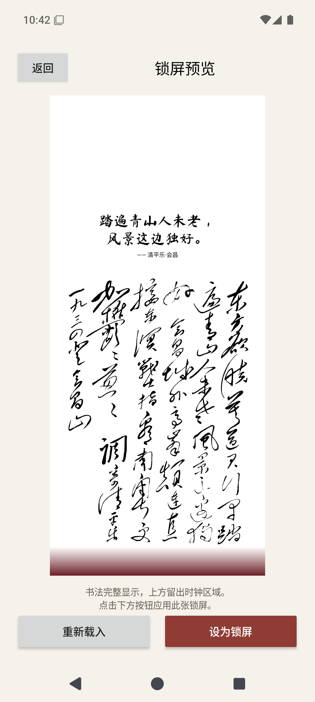
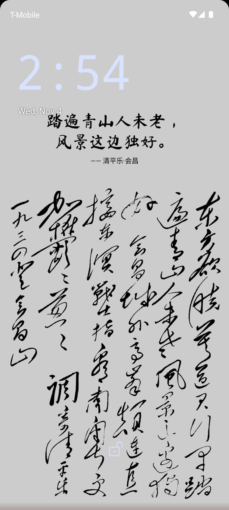

# 毛泽东诗词：每日一句/AI寻句

**向东 · Android 1.1**

每天读一句毛泽东诗词，欣赏配套书法；写下心情、处境或想表达的意思，寻找有出处的原句，并回到整首诗或原文阅读。

**[下载安装包](https://github.com/arsbai/mao-poetry-daily-ai/releases/tag/v1.1)** · **[全部界面截图与说明](docs/界面说明.md)** · **[完整使用说明](docs/使用说明.md)**

支持 Android 8.0 及以上版本。安装包和纯文字知识库放在 Releases 中；源码可通过 Code → Download ZIP 下载。本版本为体验版，沿用向东 1.0 的测试签名。

## 界面预览

<p>
  
  
  
</p>
<p>
  
  
  
</p>

截图来自 Android 15 模拟器实际运行。全部页面及功能状态的入口、用途和操作见[截图说明](docs/界面说明.md)。寻句示例使用本地原文检索，未填写真实模型密钥。

## 功能

| 功能 | 使用方式 |
|---|---|
| 每日一句 | 横排日期、每日选句、对应书法；点击阅读整首诗，支持换句和收藏 |
| AI 寻句 | 输入困难、凯旋、方向等情境；离线检索可直接使用，配置兼容接口后可由模型理解和筛选 |
| 原典书房 | 搜索篇名和正文，筛选诗词、著作，阅读全文、查看出处和收藏 |
| 每日更新 | 从指定平台公开接口检查诗词，保留本机可用资料；支持手动更新和自建服务 |
| 桌面组件 | 展示当天选句，支持尺寸调整、刷新和点击阅读原诗 |
| 诗句与书法锁屏 | 先预览再设置；作品等比例完整显示，空余区域由纸张边缘色渐变至深红，诗句采用黑色 |

模型设置支持 DeepSeek、通义千问或自定义兼容 `/chat/completions` 的服务。密钥由使用者自行填写，安卓端通过 Android Keystore 加密保存在本机。模型只对检索候选进行理解与筛选，最终引句从本地原文取出；情境联想与原文分开显示。

## 原文知识库

内置 **67 条诗词来源记录**（63 份不同全文）、**222 篇本人文字**，合计约 **94 万字符**。去重后为 **285 份原文**、**1,761 个知识片段**。

- 诗词来自[毛泽东文献数字资源平台](https://www.dlmzd.net/)，仅收录作者字段为毛泽东的正文；书法保存关联地址，用于界面展示。
- 著作、讲话、书信及访谈答语来自[中文马克思主义文库·毛泽东](https://www.marxists.org/chinese/maozedong/index.htm)所载原文转录。
- 文字包不包含图片、视频、PDF、论文、编者导语、脚注或记者提问。原文中的引文保留在正文内，不另作毛泽东独立语录。
- 每篇保留来源、日期、版本说明和校验值。作者及版本依据来源记录，尚未进行手稿级校勘，资料包也不是全部著作全集。

| 路径 | 内容 |
|---|---|
| [`corpus/txt/`](corpus/txt/) | 按篇保存的 UTF-8 纯文字 |
| [`corpus/originals.jsonl`](corpus/originals.jsonl) | 去重原文及出处 |
| [`corpus/rag_chunks.jsonl`](corpus/rag_chunks.jsonl) | 含原文位置的检索片段 |
| [`corpus/poems-report.json`](corpus/poems-report.json)、[`texts-report.json`](corpus/texts-report.json) | 采集数量、时间、未收录项目及原因 |

这里采用原文检索增强方式接入大模型，没有微调模型权重。书法不进入文字知识库，也不发送给模型。

## 本地运行与构建

电脑预览需要 Python 3.10+，仅使用标准库：

```powershell
python backend/server.py --port 8765
```

随后打开 `http://127.0.0.1:8765/`。安卓组件与锁屏需安装 APK 后使用。

Android Studio 打开 `android/`，使用 JDK 17、SDK 35。也可准备官方 Android Build Tools 35 和平台文件后执行：

```powershell
python build_apk.py --jdk "JDK目录" --tools "build-tools/35.0.0目录" --android-jar "platforms/android-35/android.jar" --output "build/XiangDong-1.1.apk"
```

构建脚本会在本机生成独立测试签名；仓库不包含签名私钥。采集、导出、自建书房服务和模型连接的具体步骤见[完整使用说明](docs/使用说明.md)。

## 验证与适用范围

检索和原文清理共 15 项测试通过；原生展示检查包含 730 天选句一致性、42 组作品与屏幕比例，共 1,590 项断言。APK 编译和签名验证通过。实际界面验证与截图记录见[界面说明](docs/界面说明.md)。

```powershell
node --test tests/engine.test.cjs
python -m unittest discover -s tests -p "test_*.py"
```

后台更新受系统省电和网络条件影响；厂商桌面与锁屏仍需对应手机验证。真实模型调用需自行配置接口和密钥。书法作品按来源关联展示；界面排印使用 Ma Shan Zheng 字体，其许可证见 [`web/FONT-LICENSE.txt`](web/FONT-LICENSE.txt)。
