# 全部界面截图与说明

项目：**毛泽东诗词：每日一句/AI寻句**；应用名：**向东**；版本：**Android 1.1**。

以下图片来自实际运行界面。模型页面未填写真实密钥，寻句示例展示本地原文检索。书法为来源网站关联的原作配图，截图不表示重新授予其独立使用许可。

## 01 · 每日一句

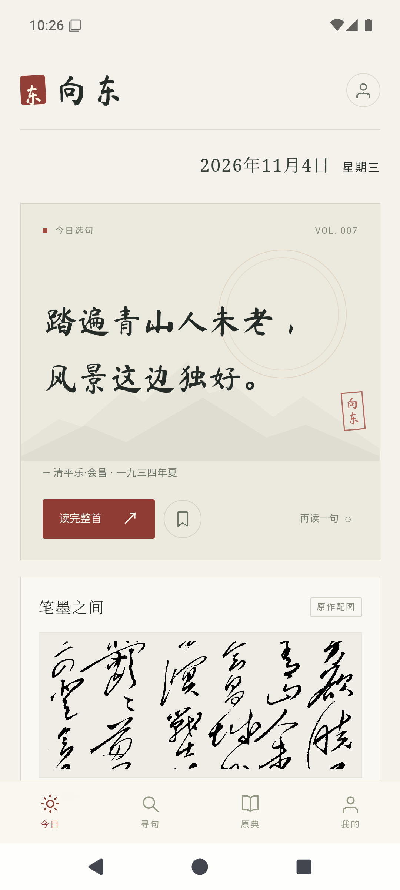

- **入口**：启动应用，或底部“今日”。
- **用途**：按日期呈现一句诗，展示篇名、创作时间和对应书法。标题区仅保留横排日期。
- **操作**：“读完整首”进入原诗；书签收藏；“再读一句”切换另一句；点击配图放大书法。

## 02 · 寻句输入

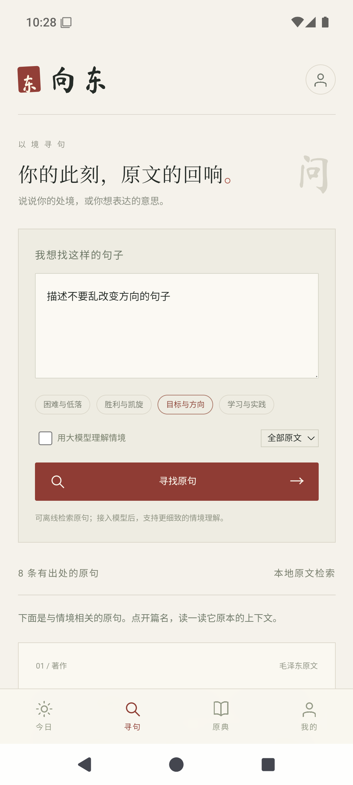

- **入口**：底部“寻句”。
- **用途**：输入心情、处境或想表达的意思。
- **操作**：可选困难、凯旋、方向、学习等示例；选择全部原文、诗词或著作。“用大模型理解情境”需要先在“我的”配置兼容接口和密钥。

## 03 · 困难与低落的寻句结果

- **入口**：输入“我现在遇到困难了，很难过”，点击“寻找原句”。
- **用途**：显示逐字来自本机原文的句子、篇名、日期，以及单独标注的情境联想。
- **操作**：打开原文上下文或收藏。没有密钥时仍可使用本地检索。

## 04 · 凯旋情境与诗词筛选

- **入口**：“胜利与凯旋”，并将类型选为“只看诗词”。
- **用途**：从诗词中寻找凯旋、告捷和胜利意象，不将普通词语匹配误作相关证据。
- **操作**：点击“读完整首”核对具体语境。

## 05 · 原典书房

- **入口**：底部“原典”。
- **用途**：浏览 67 条诗词来源记录和 222 篇本人文字。
- **操作**：按全部、诗词、著作切换，向下继续翻阅，点击任一篇目阅读全文。

## 06 · 原典搜索

- **入口**：原典书房的“搜索篇名或原文”。
- **用途**：同时检索篇名和全文，适合查找已知作品或关键词。
- **操作**：输入“长征”等词，点击结果进入原文。

## 07 · 我的收藏

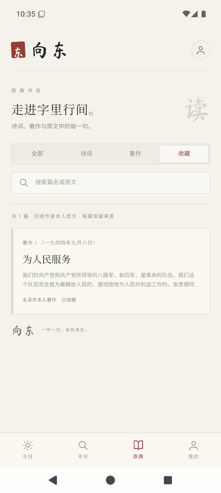

- **入口**：原典书房 → “收藏”。
- **用途**：集中查看在首页、寻句结果或全文阅读中收藏的篇目。
- **操作**：打开篇目后再点书签可取消收藏。收藏保存在本机。

## 08 · 整首诗词阅读

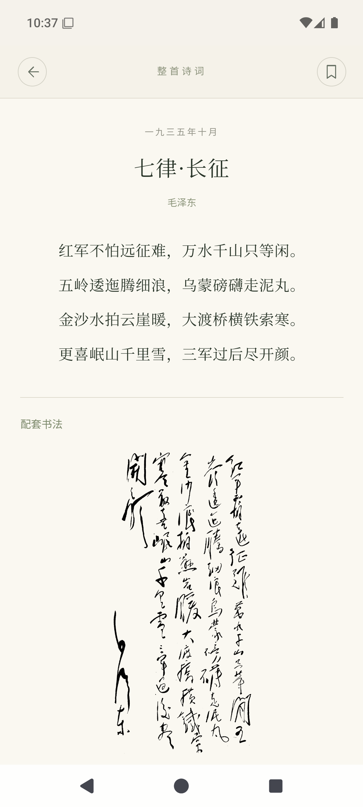

- **入口**：首页或寻句结果的“读完整首”，或点击书房中的诗词。
- **用途**：展示整首诗、作者、创作时间，继续向下可查看对应书法与来源。
- **操作**：书签收藏，返回关闭阅读；来源链接交由浏览器打开。

## 09 · 著作原文与上下文

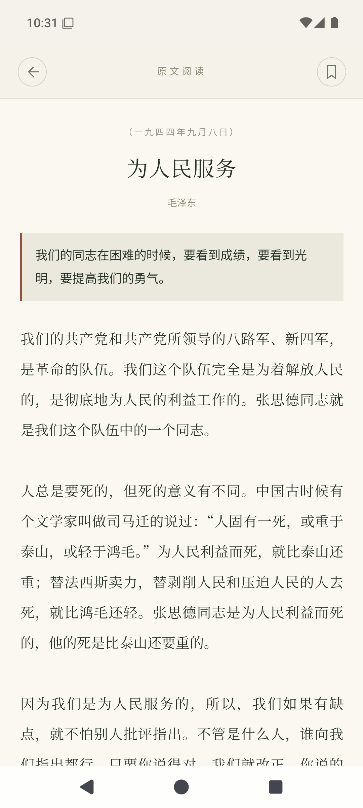

- **入口**：寻句结果的“看原文上下文”，或书房中的著作。
- **用途**：把选句放回全文中阅读；从结果进入时保留原句提示及正文标记。
- **操作**：滚动阅读全文，核对篇名和出处，或收藏本文。

## 10 · 书法放大

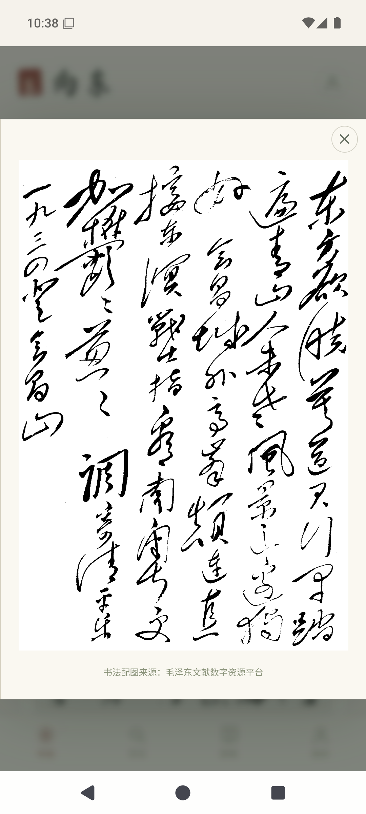

- **入口**：今日 → “笔墨之间”的配图。
- **用途**：完整赏读与当前诗词关联的书法作品，并标明来源。
- **操作**：右上角关闭返回首页。原图需要网络。

## 11 · 大模型连接

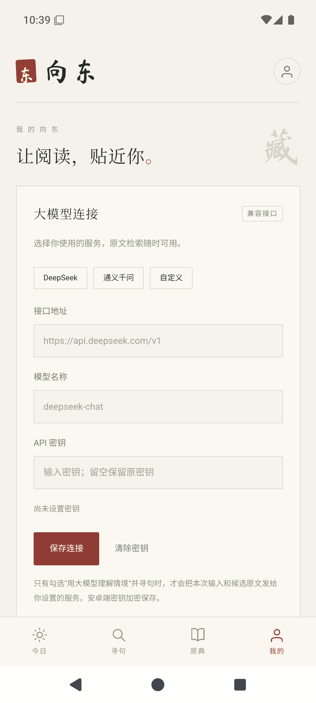

- **入口**：底部“我的”。
- **用途**：选择 DeepSeek、通义千问或自定义兼容接口，填写服务地址、模型名称和 API 密钥。
- **操作**：“保存连接”后在寻句页启用模型理解。安卓端密钥通过 Android Keystore 加密保存；截图中的密钥为空。

## 12 · 每日更新与书房服务

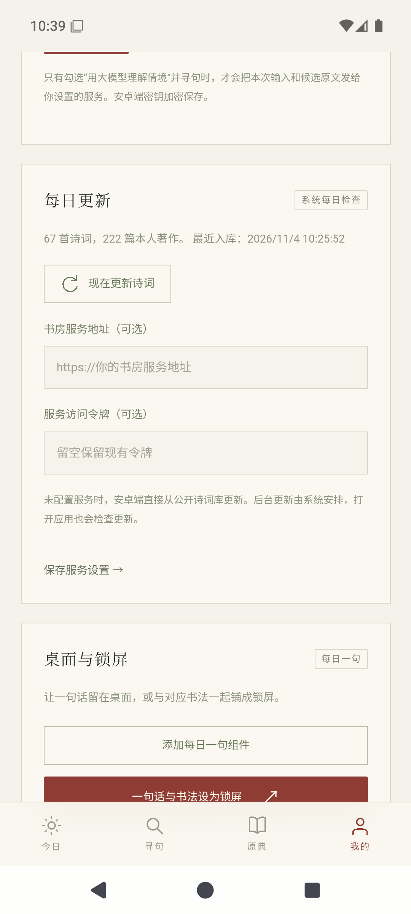

- **入口**：“我的”向下滚动至“每日更新”。
- **用途**：查看本机收录数量和入库时间，手动更新诗词；也可填写自己的书房服务地址。
- **操作**：点击“现在更新诗词”；服务地址及令牌为可选项。系统后台更新受省电和网络状况影响。

## 13 · 桌面与锁屏入口

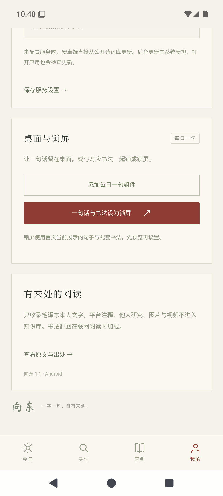

- **入口**：“我的” → “桌面与锁屏”。
- **用途**：添加每日一句桌面组件，或将首页当前的一句话与对应书法生成锁屏。
- **操作**：先在首页选好一句，再进入锁屏预览；组件始终使用当天的默认选句。

## 14 · 桌面组件添加

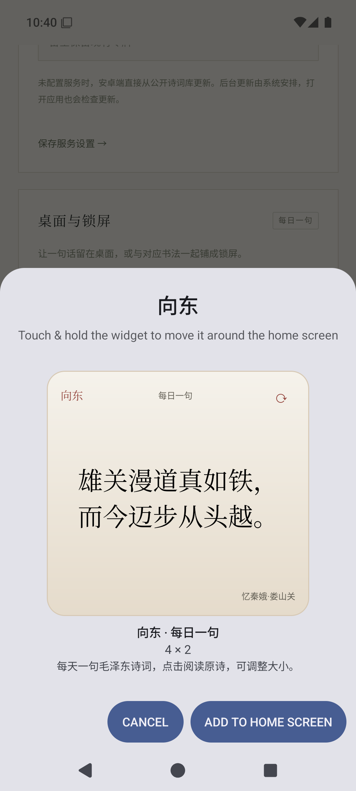

- **入口**：“添加每日一句组件”，或长按系统桌面空白处 → 小组件 → “向东 · 每日一句”。
- **用途**：通过系统桌面确认组件的位置和尺寸。
- **操作**：在系统提示中完成添加。不同桌面软件的外观和步骤可能略有不同。

## 15 · 每日一句桌面组件

- **入口**：添加后的系统桌面。
- **用途**：不打开应用也能阅读当天诗句、日期和篇名。组件从本机资料库读取，无需模型密钥。
- **操作**：点击正文打开原诗；点击右上角圆箭头刷新；长按后拖动边缘调整大小，小尺寸会收起篇名。

## 16 · 锁屏构图预览

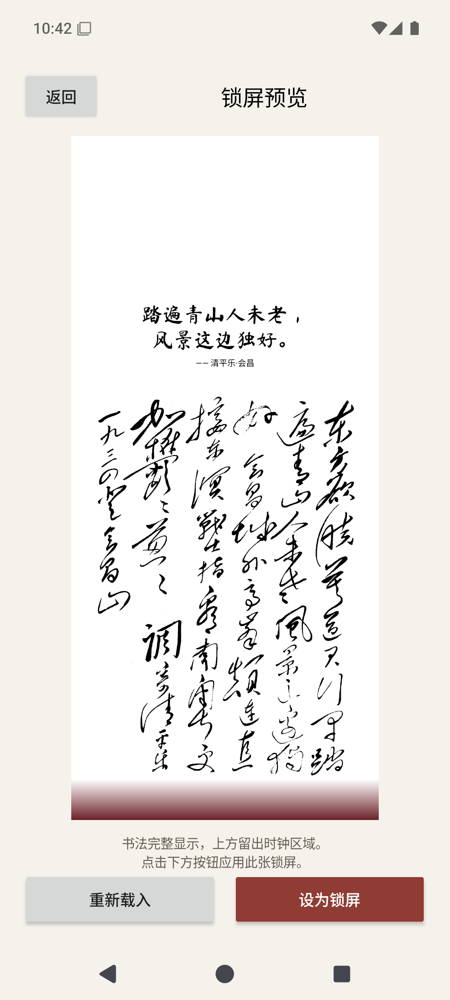

- **入口**：“我的” → “一句话与书法设为锁屏”。
- **用途**：根据当前屏幕比例，将黑色诗句和对应书法排成锁屏；书法等比例完整显示，留白由纸张边缘色向深红色渐变。
- **操作**：“重新载入”重试原图；“设为锁屏”应用当前构图；“返回”取消。上方为空间预留区，预览中的留白用于容纳系统时钟。

## 17 · 实际锁屏效果

- **入口**：在锁屏预览中设置后，锁定设备并唤醒屏幕。
- **用途**：展示系统时钟叠加后的实际锁屏效果。
- **说明**：此处为模拟器系统的效果，测试设备使用紧凑时钟样式。系统会叠加时钟、日期、解锁图标，并可能暗化或缩放壁纸；手机厂商的效果可能不同。大时钟可能覆盖作品，可在手机系统中调整时钟样式。每次设置生成一张静态锁屏，换句后可再次预览并设置。

## 界面与测试边界

截图中的检索结果均保留原句、篇名和来源，不展示伪造的模型回复。真实模型调用需自行提供兼容接口和密钥。截图设备与系统版本记录在同目录的 `capture-info.json` 中；硬件厂商桌面和锁屏的差异仍需对应真机验证。
